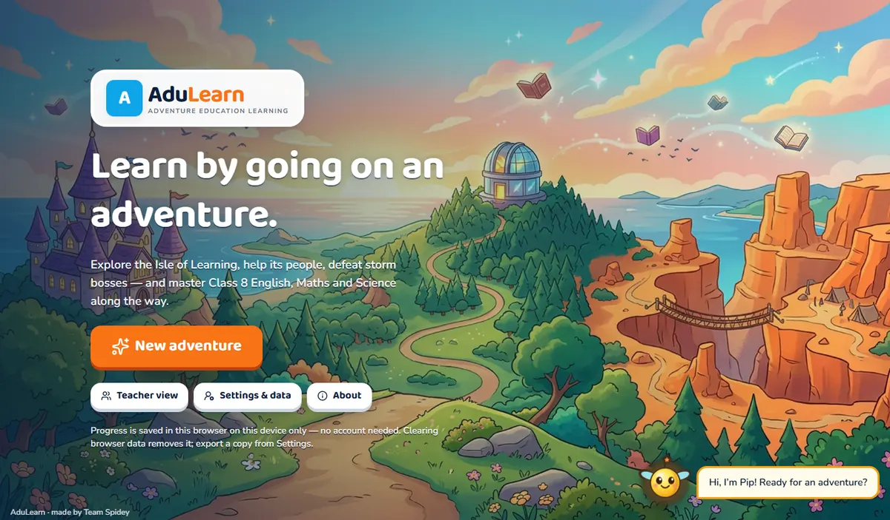
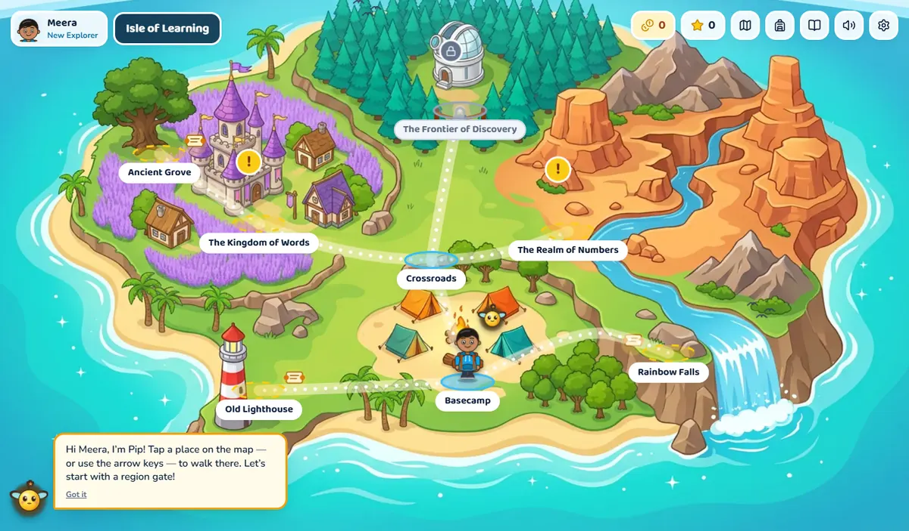
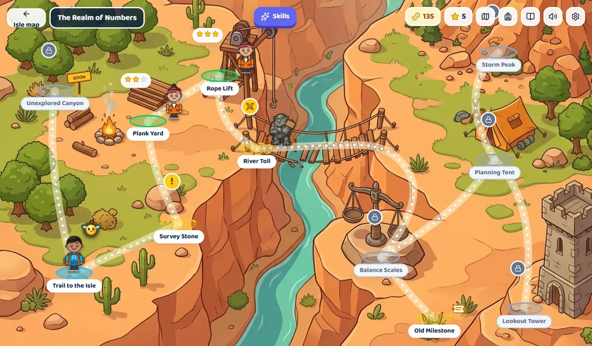
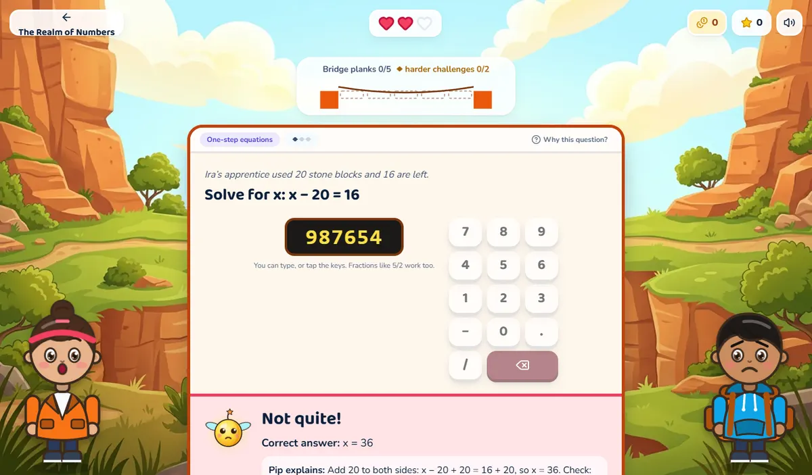
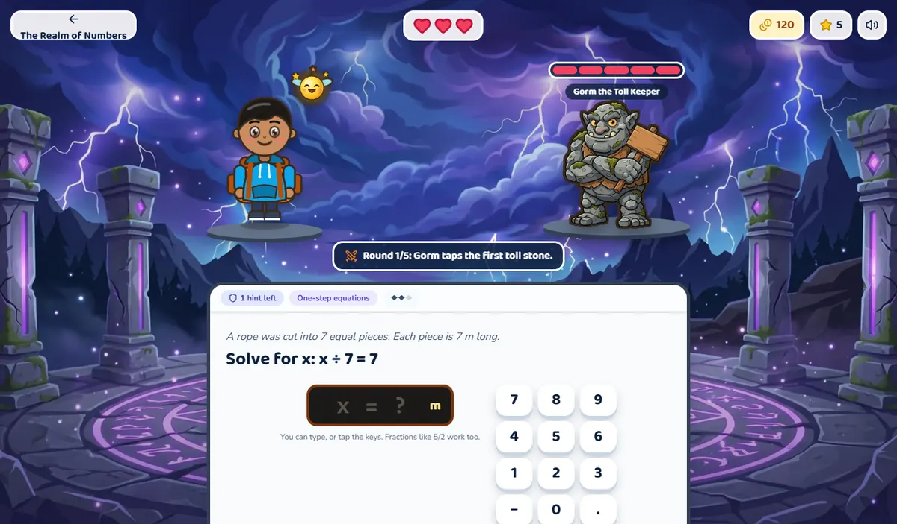
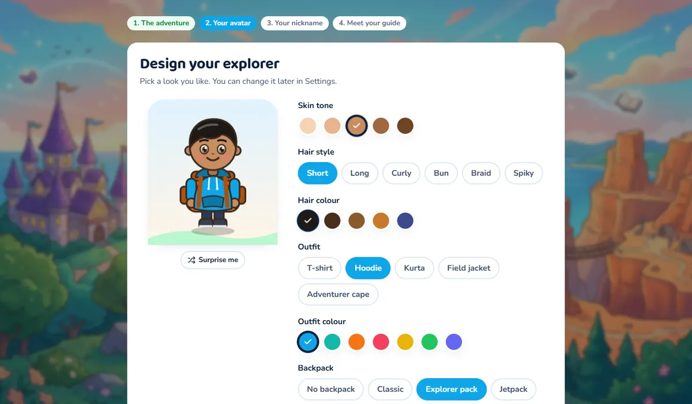
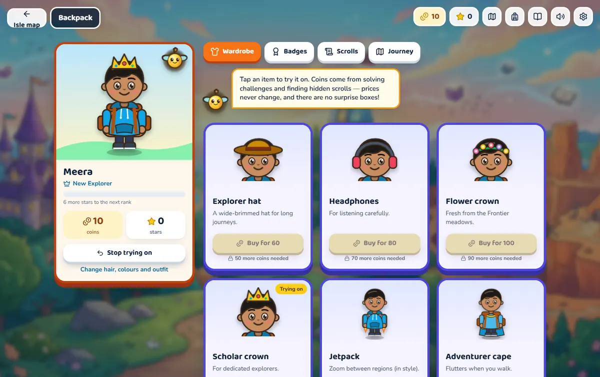

# AduLearn — Adventure Edu Learning Platform

**Team Spidey** · Gamified learning prototype for Class 8 students following the Andhra Pradesh SSC curriculum.

AduLearn turns school learning into a story-driven adventure game. Students create an avatar, walk around a painted island and its three subject regions with Pip (their mascot companion), take on missions given by characters, solve freshly generated challenges with game-style controls, battle storm bosses, earn stars and coins, and watch the world change as they learn. Progress is stored locally in the browser — no account, server or internet connection is needed to play.

### The game layer

- **Explorable maps** — a painted overworld (Isle of Learning) and three painted region maps. The avatar walks between places (tap/click, or arrow keys + Enter); Pip follows and talks. Places show locked / ready (“!”) / completed (stars). Locked places block the path. Scenery reacts to progress (storm clouds lift, flags rise, barriers open, sparkles appear).
- **Missions as conversations and puzzles** — visual-novel story intro, then every challenge is a conversation with the mission's character: they explain the situation and ask, you reply by choosing what to say, typing a reply, cracking a code lock (number keypad), or solving a puzzle (connect the pairs, unscramble a sentence, pin labels on a specimen). Multi-step problems unfold one step at a time. Pip chimes in with hints, and the character reacts to your answer and explains. Progress track (bridge planks, books, energy cells), coin bursts, breaking hearts, 1–3 star victory screens.
- **Hands-on science labs** — chemistry and physics challenges are experiments, not quizzes: test a sample with a hammer, circuit tester, sandpaper, wire puller or striker and shelve it as a metal or non-metal; burn an element, dissolve its oxide, predict, then watch the litmus change; bring a magnet, foot or balloon towards an object to see whether a force needs contact; measure a crate with a force meter and tape to set a pressure gauge; swap base plates or load weights in a sand pit until it stops (or starts) sinking; stand a brick on different faces to compare pressure. Every drag has a tap alternative, and answers are still graded by the same keys.
- **Painted characters** — the story characters, Pip and four playable heroes (chosen during setup) are painted, story-game style sprites; see [`docs/ASSETS.md`](docs/ASSETS.md).
- **Boss battles** — an arena with the boss's health bar; correct answers fire a knowledge bolt, wrong answers let the boss strike back.
- **Economy and Backpack** — coins only for new correct answers (fewer with hints, a few for review, none for checks) and first-time scroll discoveries; stars per mission/boss; explorer ranks. The Backpack (HUD bag icon or Basecamp) has a **wardrobe shop** (try items on, fixed prices, confirm before buying, wear / take off — no randomness or loot boxes), **badges**, found **scrolls** with hints for the rest, and **journey** stars per region. Synthesized sound effects with a mute button.
- **Art** — painted backgrounds, characters and a boss sprite generated for the project (see [`docs/ASSETS.md`](docs/ASSETS.md)); the map explorer and all interactive pieces are SVG so they stay customisable and animated.

> **Content notice.** The bundled chapters are **illustrative samples** written for this prototype. They have **not** been checked against the official AP SSC Class 8 textbooks and are not a complete curriculum. Every question template carries review and curriculum-alignment metadata; teachers can approve or reject templates on the device.

---

## Features

| Area | What works today |
| --- | --- |
| Onboarding | Welcome screen, choice of four painted heroes plus an 8-option map-explorer editor with live preview, nickname (no real name needed), guide introduction, returning-explorer list |
| Adventure world | Illustrated, clickable world map; three regions with locked / open / completed states; Science unlocks after any one mission |
| Playable chapters | **Mathematics — Bridge of Balance** (4 missions, mini-boss, chapter boss), **English — The Lost Library** (3 missions, boss), **Science — Field Station Alpha** (biology, chemistry and physics missions, boss) — each with diagnostic and follow-up checks |
| Question engine | 37 deterministic, seeded templates; 7 question types (multiple choice, numeric, text/fill-in/sentence correction, matching, word-order sentence building, diagram labelling, multi-step); every instance is validated before use; variant history avoids repeats |
| Answer checking | Deterministic: equivalent numbers (`5/2`, `2.5`, `x = 2.5`, units), accepted text variants, multiple accepted word orders, partial credit for multi-part answers, misconception detection |
| Adaptive learning | Transparent rule-based mastery estimates per concept; difficulty steps up after independent success and eases after repeated misses; targeted hints; every question explains *“Why this question?”* |
| Game mechanics | Hearts per mission, refresh-proof (resuming keeps hearts), out-of-hearts screen with targeted practice and retry using new variants, milestone rewards (no streaks or loot boxes) |
| Bosses | Generated from blueprints (required concepts, difficulty, types, pass rules, hint limits); multi-step problems; failure leads to targeted practice and a different challenge |
| Assessments | Optional starting check and follow-up check (unlocked after the chapter boss) with different questions; transparent per-concept comparison with stated limitations |
| Teacher dashboard | Opens on a class dashboard: stat tiles, a leaderboard (stars, accuracy, coins, assignment average), answers per day, accuracy by subject and per-question assignment results. Twelve clearly labelled **sample students** can be switched on or off for demonstrations |
| Assignments | Teachers create, edit, duplicate, publish/unpublish and delete tests and quizzes (multiple choice, short answer, number with tolerance and unit), with attempt limits, an optional due date and an option to show answers afterwards; students attempt and re-attempt them from *Assignments* (best score counts, late submissions are marked); teachers see every student's scores |
| Teacher view | Local PIN gate; overview of explorers on the device, concepts that may need reteaching, repeated error patterns; per-student detail with mastery evidence, attempts, bosses and check comparisons; printable report; per-student JSON export; content review (approve / pending / reject) with live previews |
| Data | IndexedDB (Dexie) with versioned schema and migration; JSON export/import with validation; confirmed destructive actions; dev-only demo data |
| Optional AI | Ollama integration for alternative explanations, extra hints and dialogue rephrasing — schema-validated, safety-filtered, answer-leak checked, cached, with timeouts and fallback to approved content |
| Accessibility | Keyboard navigation, visible focus, labelled controls, non-colour status indicators, reduced-motion support (system or manual), larger-text option, responsive layouts down to phone width |

---

## Technology stack

React 19 · TypeScript (strict) · Vite 7 · Tailwind CSS 4 · Framer Motion · Lucide icons · Dexie (IndexedDB) · Zod · React Router 7 · Vitest + React Testing Library · Playwright.

UI primitives (buttons, cards, dialogs, badges) are small local components in `src/components/ui.tsx` written in the shadcn style rather than installing shadcn/ui and Radix, to keep the dependency footprint small. Dialogs use the native `<dialog>` element for focus handling.

## Prerequisites

- Node.js 20 or newer (developed with Node 24) and npm
- A modern browser (Chrome, Edge, Firefox, Safari)
- Optional: [Ollama](https://ollama.com) for local AI features

## Installation and development

```bash
npm install
npm run dev
```

The app runs at <http://localhost:5173>.

| Command | Purpose |
| --- | --- |
| `npm run dev` | Development server |
| `npm run build` | Typecheck and production build into `dist/` |
| `npm run preview` | Serve the production build |
| `npm run typecheck` | TypeScript project check |
| `npm test` | Unit, integration and component tests (Vitest) |
| `npm run test:e2e` | Browser tests (Playwright) |
| `npm run format` | Format with Prettier |
| `node scripts/screenshots.mjs <dir>` | Capture the main game screens (needs the e2e build served on port 4175) |
| `node scripts/optimize-images.mjs <dir>` | Convert source art PNGs to optimised WebP |

### Browser tests

```bash
npx playwright install chromium   # first time only
npm run test:e2e
```

Playwright builds the app with `--mode e2e` into `dist-e2e/` and serves it on port 4174. That build includes a small test-only hook (`window.__adulearnTest`) so tests can answer questions through the real UI. The hook is switched on by `VITE_E2E=true` in the committed `.env.e2e` file, which Vite reads only in `e2e` mode, so the tests work in a fresh clone and **normal builds (`npm run build`) do not contain it**.

If your OS blocks Playwright's downloaded browser (for example Windows Smart App Control / application-control policies), use an installed, signed browser instead:

```bash
PW_CHANNEL=msedge npm run test:e2e     # or PW_CHANNEL=chrome
```

---

## Local data: how it is stored and its limits

- Structured data (profiles, attempts, variant history, mastery, mission progress, active runs, boss results, assessments, rewards, content-review decisions, assignments and assignment attempts, teacher PIN hash, AI cache) lives in **IndexedDB** via Dexie (`src/data/db.ts`). The schema is versioned (currently v4) with upgrade steps.
- Small per-device preferences (motion, text size, “why this question” toggle, Ollama endpoint/model) live in `localStorage` (`src/lib/prefs.ts`). Storage failures fall back to defaults.
- Only pseudonymous data is stored: a random profile id, a nickname, an avatar and learning records. No real name, email, phone number or location.

**Limitations — please read:**

- Data belongs to **this browser profile on this device**. It does not follow the student to another device.
- **Clearing browser data** or using a private window can remove it.
- Browser storage is **not a secure backup**. Use *Settings → Export progress* and keep the file safe; *Import* never overwrites explorers that already exist.
- Assignments and the dashboard only see explorers **in this browser**. A whole class needs to share one device/browser profile until a server is added. Assignments are not included in the JSON export.
- The teacher PIN only discourages casual access. Anyone with full access to the device can read or erase local data.
- Because grading runs in the browser, answer keys cannot be truly secret: they are kept out of question payloads and UI state (see `AnswerVault`), but a determined user with developer tools could find them.

---

## Running without Ollama

Nothing to do — AI is **off by default**, and every feature works without it.

## Optional: Ollama setup

1. Install Ollama and pull a small model, e.g. `ollama pull llama3.2:3b` (AduLearn never downloads models itself).
2. Make sure Ollama is running (`ollama serve`). By default it accepts requests from `localhost` pages. If the browser reports a CORS error, allow the app's origin, e.g. `OLLAMA_ORIGINS=http://localhost:5173`.
3. In AduLearn open **Settings → Optional local AI**, tick *Use local AI features*, keep the address `http://localhost:11434`, press **Test connection**, choose the model, and set a time limit.

What the AI is used for: *Explain it another way* after a wrong answer, *Ask for another hint* (after an approved hint), and *Say it differently* in story dialogue.
What it is **never** used for: grading, answer keys, mastery estimates, unlocking, or content approval. Output must match a JSON schema, pass length and safety checks, keep numbers intact (dialogue), and not reveal the answer (hints); otherwise the approved text is shown with a note. Prompts contain no profile data.

---

## Educational content structure

```
src/content/
  manifest.ts            regions → chapters → nodes; concepts, missions, bosses, assessments
  templates/*.ts         question templates (one file per chapter)
  story/scenes.ts        dialogue scenes (data, not UI)
  characters.ts          story characters (reuse the avatar renderer)
  misconceptions.ts      teacher-facing labels and reteaching suggestions
  index.ts               registry, lookups, approval checks, manifest validation
```

Each **template** declares: id, version, grade, subject, chapter, concept, learning objective, difficulty (1–3), question type, variable definitions and ranges, an optional constraint, a `build` function producing the student-facing view, the answer key, hints and explanation, review status and curriculum-alignment metadata, and assessment eligibility (including transfer questions).

Review statuses: `draft`, `pending-review`, `approved`, `rejected`. **Only `approved` templates reach students.** The bundled samples are marked approved by the team's prototype content check, with curriculum alignment `unverified-illustrative`. A few templates are deliberately left `pending-review` / `draft` to demonstrate the workflow; a teacher can approve them in *Teacher view → Content review* (stored on the device).

### How to add a chapter

1. Add its concepts to `CONCEPTS` in `src/content/manifest.ts`.
2. Add a `Chapter` with ordered `nodes` (missions, bosses, optional diagnostic, follow-up) and their `requires` links; reference it from its region's `chapterIds`.
3. Add `Mission` entries (concept mix, difficulty range, goal, hearts, intro/outro scenes, optional lab) and `BossBlueprint` entries (rounds, pass rules, hint limit).
4. Add an `AssessmentBlueprint` and set the chapter's `assessmentId`.
5. Write templates in `src/content/templates/<chapter>.ts` and include them in `TEMPLATES` in `src/content/index.ts`.
6. Add the story scenes in `src/content/story/scenes.ts`.
7. Run `npm test` — `validateContent()` checks every cross-reference, and every template is probed with many seeds.

No application logic changes are needed.

### How to add a question template

```ts
defineTemplate({
  id: 'math.eq.example', version: 1, grade: 8, subject: 'mathematics',
  chapterId: 'math-equations', conceptId: 'math.eq.one-step',
  title: 'One-step equation: x + a = b', objective: 'Solve x + a = b.',
  difficulty: 1, type: 'numeric',
  review: PENDING, curriculum: ILLUSTRATIVE,
  assessment: { eligible: true },
  variables: { x: int(1, 20), a: int(2, 15) },
  constraint: ({ x, a }) => (x !== a ? null : 'x and a should differ'),
  build: ({ x, a }) => ({
    view: { prompt: `Solve for x:  x + ${a} = ${x + a}`, body: { kind: 'numeric' } },
    key: {
      body: { kind: 'numeric', value: x, misconceptions: [{ value: x + 2 * a, misconceptionId: 'math.inverse-operation', feedback: 'Subtract, don’t add.' }] },
      answerDisplay: `x = ${x}`,
      explanation: `Subtract ${a} from both sides: x = ${x}.`,
    },
    hints: [`Undo “+ ${a}” on both sides.`],
  }),
})
```

### How to create and validate a generator

- Keep all randomness in `variables` (sampled from the seeded RNG) and use the `rng` argument for shuffling — the same seed must always produce the same question (review mode relies on this).
- Use `constraint` to reject invalid combinations; use `buildMcq()` for multiple choice so ids are opaque and shuffled.
- Every generated instance is validated by `validateInstance()` (Zod structure + semantic checks: correct choice present, unique choices, bijective matching, word-order tokens consistent, etc.). Invalid instances are rejected and regenerated.
- `src/core/engine/generator.test.ts` probes **every** template with 150 seeds and fails on any validation error; the teacher's content review shows the same probe for each template.

---

## Known limitations

- Content is an illustrative sample, not a verified curriculum; Telugu explanations are not yet available (the content structure is ready for reviewed translations).
- Mastery estimates come from simple, transparent rules and are not a validated measure of ability. Assessment comparisons describe observed performance only.
- Single-device, browser-only storage; no sync, accounts or multi-school management.
- No offline/PWA install yet: the app works offline only while already loaded.
- Open-ended free-text answers are limited to approved answer sets; there is no human-review queue for free responses yet.
- Testing with schoolchildren requires appropriate school permission, adult supervision and applicable consent procedures.

See [`docs/IMPLEMENTATION_STATUS.md`](docs/IMPLEMENTATION_STATUS.md) for a detailed status table and [`docs/ARCHITECTURE.md`](docs/ARCHITECTURE.md) for the design.

## Future mobile app strategy

Everything under `src/core/` (types, schemas, generator, grader, vault, mastery, adaptive selection, runs, bosses, progression, assessments, story machines, avatar schema) and `src/content/` is plain TypeScript with no React, DOM or IndexedDB dependency. A React Native / Expo app can import these modules unchanged and provide:

- its own UI components (the web components in `src/components` and `src/features` are not reused);
- a storage adapter implementing the same repository functions as `src/data/repositories.ts` (e.g. SQLite or MMKV);
- the same Ollama client (`src/services/ai/ollama.ts` only depends on `fetch`).

React Native has deliberately not been added to this repository.

## Branding

Place the supplied AduLearn logo at `src/assets/brand/adulearn-logo.png` (or `.svg` / `.webp`). It is picked up automatically at build time; until then a simple text wordmark placeholder is shown. Team Spidey appears in the footer and About page.

## Screenshots

| | |
| --- | --- |
|  |  |
|  |  |
|  |  |
|  | |
